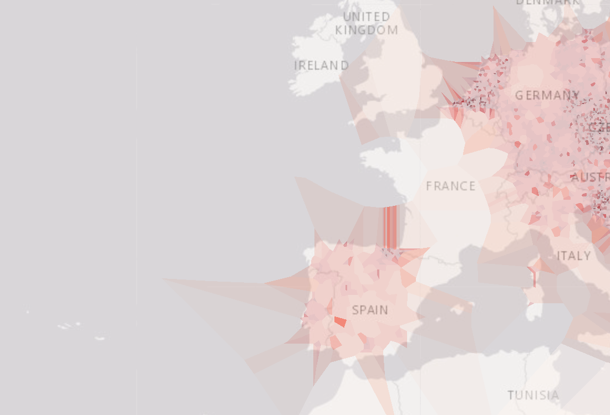

# Analysis and Visualization of European City Density

## Research Question

How are cities distributed across Europe, and what geographic patterns can be identified through data visualization?

## Dataset

This project uses the `world_cities_pop.csv` dataset.

The dataset contains:

- Country code
- City name
- Region
- Population
- Latitude
- Longitude

The dataset was provided for educational use in the CISC7204 course. It is used only for academic and learning purposes.

## Methods and Tools

The project uses:

- Python
- pandas
- NumPy
- geoplotlib
- Jupyter Notebook
- GitHub

The main steps include:

1. Loading the city dataset.
2. Renaming the latitude and longitude columns.
3. Filtering the dataset to European cities.
4. Filtering cities according to their first letter.
5. Creating a dot-density plot.
6. Creating a Voronoi visualization.
7. Creating an interactive custom layer.

## Visualizations

### Dot-Density Plot


This plot shows the geographic distribution of European cities. Areas with more points contain a higher concentration of city records.

### Voronoi Visualization



The Voronoi visualization shows regions around selected cities and helps describe the spatial relationship between nearby locations.

## Key Findings

The results show that cities are not evenly distributed across Europe. Central Europe, Western Europe, and parts of Southern Europe contain a higher concentration of city records.

Filtering cities by their first letter also produces different geographic patterns. The interactive layer allows users to compare these patterns by pressing the left and right arrow keys.

## Limitation

Some population values are missing. Therefore, the visualizations mainly describe the distribution of city records rather than actual population density. Some city names may also appear more than once because of different records or spellings.

## How to Run the Project

Install the required packages:

```bash
pip install -r requirements.txt
